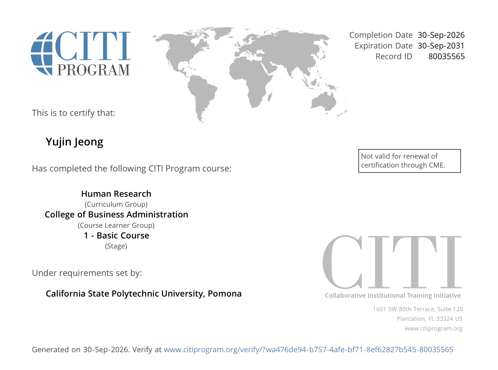

## 1. Introduction

This report provides evidence of the successful completion of the required CITI Program training for California State Polytechnic University, Pomona. The completed module is the **College of Business Administration** module, which includes the "CPP Introduction to human subjects 101" course.

* **Completion Date:** September 30, 2026
* **Record ID:** 80037947

## 2. CITI Training Certificate

Below is the screenshot of the official Completion Certificate:

## 3. Appendix: Publication Links

* [GitHub Repository](https://github.com/jennyjeong53/CITI-Certification)
* [Published CITI Certification Report](https://jennyjeong53.github.io/CITI-Certification/)